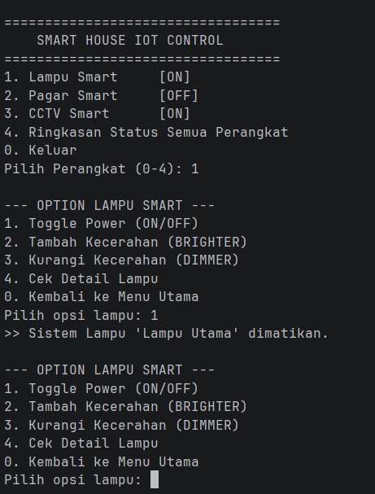
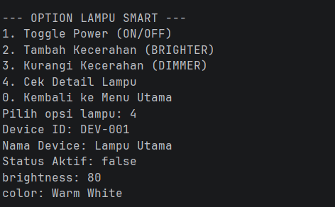

project oop sistem smart home

Nama : Haiban Aufar Irwanov
Nim : H1D025085

Tema: IOT

##  Konsep OOP yang Diterapkan

* **Abstraction (Abstraksi):**
    * `Device` berfungsi sebagai *abstract class* yang menyediakan fondasi umum perangkat tanpa mengimplementasikan logika spesifik `command()`.
    * Interface `Controll` dan `DeviceKeamanan` mendefinisikan standar method yang wajib diimplementasikan oleh kelas perangkat yang relevan.
* **Inheritance (Pewarisan):** Kelas `Lampu`, `Gate`, dan `Cctv` mewarisi atribut umum (`deviceId`, `name`, `On`) dan fungsi dasar (`display()`, getter/setter) dari kelas induk `Device`.
* **Polymorphism (Polimorfisme):**
    * **Interface Polymorphism:** Penggunaan variabel bertipe interface (seperti `Controll` dan `DeviceKeamanan`) untuk merujuk pada objek konkret (`Lampu` dan `Cctv`).
    * **Method Overriding:** Setiap subclass mendefinisikan ulang method `turnon()`, `turnoff()`, `display()`, dan `command()` sesuai karakteristik perangkat masing-masing.
    * **Constructor Overloading:** Setiap kelas perangkat menyediakan lebih dari satu constructor untuk variasi inisialisasi objek.
* **Encapsulation (Enkapsulasi):** Variabel instans bersifat `private` dan diakses/diubah secara aman melalui method *getter*, *setter*, atau method logika `command()`.
 
cara compile melalui terminal
javac -d out/production/IOT src/Main.java

cara run melalui terminal
java -cp out/production/IOT\ Main 

contoh output
menu awal

pilih perangkat lampu dan pilih opsi 1

pilih opsi 4 untuk melihat detail lampu

